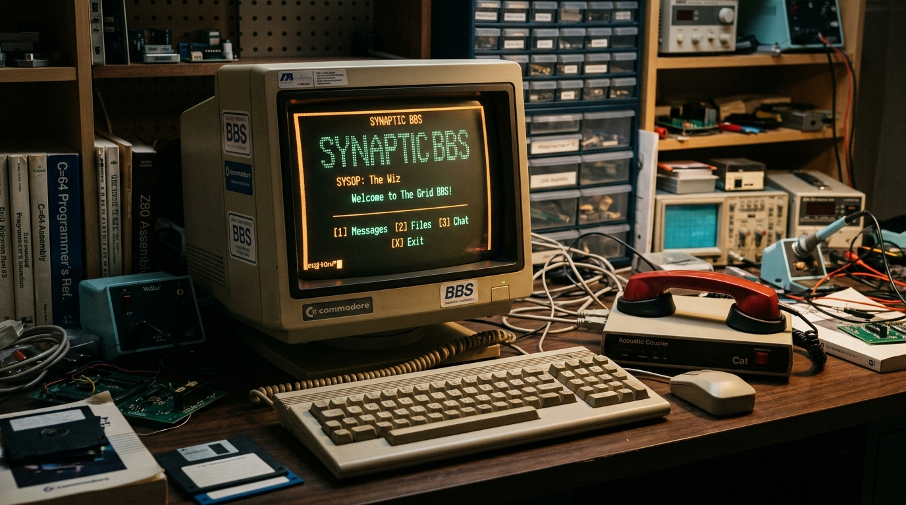

# Ivory Tower BBS (Local & Off-Grid Bulletin Board System)

<div align="center">
  
</div>

<div align="center">

[](https://opensource.org/licenses/Apache-2.0)
[](#offline-first-storage--3-way-vector-conflict-resolution)
[](#cryptographic-architecture-e2ee-pbkdf2--mfa)
[](#bell-202-afsk-acoustic-audio-modulator--ctcss-sub-tones)
[](#multilingual-support--localization)
[](#installation--production-deployment)

</div>

> **Ivory Tower BBS** is an authentic, offline-first Bulletin Board System engineered for emergency communications, neighborhood mesh collectives, amateur radio operators, and decentralized community coordination. Featuring a retro CRT phosphor terminal, ANSI VT100 / CP437 box-drawing rendering, zero-knowledge client-side encryption (AES-256-GCM), a Bell 202 AFSK acoustic audio coupler, APRS meteorological telemetry, and a complete SysOp administration suite.

---

## 📑 Table of Contents

1. [Overview & Philosophy](#1-overview--philosophy)
2. [Key Features & Capabilities](#2-key-features--capabilities)
3. [Multilingual Support & Localization](#3-multilingual-support--localization)
4. [Mesh Topology & Hardware Architecture](#4-mesh-topology--hardware-architecture)
5. [Interactive Command-Line Interface (CLI) & Hotkeys](#5-interactive-command-line-interface-cli--hotkeys)
6. [Interactive Starter Guide & Walkthrough](#6-interactive-starter-guide--walkthrough)
7. [Packet Radio, APRS Weather & Solar Telemetry](#7-packet-radio-aprs-weather--solar-telemetry)
8. [Bell 202 AFSK Acoustic Audio Modulator & CTCSS](#8-bell-202-afsk-acoustic-audio-modulator--ctcss)
9. [Cryptographic Architecture (E2EE, PBKDF2 & MFA)](#9-cryptographic-architecture-e2ee-pbkdf2--mfa)
10. [Offline-First Storage & 3-Way Vector Conflict Resolution](#10-offline-first-storage--3-way-vector-conflict-resolution)
11. [SysOp Administration Console & Emergency Net](#11-sysop-administration-console--emergency-net)
12. [Door Games, ANSI Art Studio & File Library](#12-door-games-ansi-art-studio--file-library)
13. [External Client REST API](#13-external-client-rest-api)
14. [Installation & Production Deployment](#14-installation--production-deployment)
15. [License & Attribution](#15-license--attribution)

---

## 1. Overview & Philosophy

Modern telecommunications rely heavily on centralized cloud infrastructure, distant hyperscaler data centers, and perpetual grid power. When regional power grids falter, undersea cables sever, or local connectivity collapses, vital neighborhood communication breaks down.

**Ivory Tower BBS** was conceived to solve this critical vulnerability. Operating as a completely self-contained Progressive Web Application (PWA), it runs 100% locally inside client browsers without requiring an active internet connection. Designed to thrive over solar-powered mini-servers, local Wi-Fi air-gapped captive portals, LoRa mesh transceivers, or direct acoustic audio couplings into handheld walkie-talkies.

The user interface delivers a meticulous homage to classic MS-DOS and Unix BBS systems of the 1980s and 1990s, incorporating genuine CRT green and amber phosphor glow, toggleable scanlines, mechanical keyboard audio synthesis, and real-time ANSI escape sequence rendering.

---

## 2. Key Features & Capabilities

- **Authentic Terminal User Interface (TUI)**:
  - 16-color ANSI VT100 escape sequence parser supporting standard formatting (`\x1b[31m`, `\x1b[1;32m`, etc.) and CP437 box-drawing borders (`┌─┐`, `│`, `└─┘`).
  - 5 switchable vintage themes: *Amber CRT*, *Green CRT Phosphor*, *Classic DOS (16-color)*, *Modern Monospace Dark*, and *Modern Monospace Light*.
  - Configurable CRT phosphor scanlines, battery saver mode, and accessibility font scalers (`Normal`, `Large`, `Huge`).
- **Hybrid Dual-Navigation Model**:
  - Interactive bottom command line (`BBS>`) with history memory (Up/Down arrow navigation), TAB auto-completion, and live typing suggestions.
  - ANSI touch-friendly navigation bars and hotkey triggers for mouse and mobile touchscreens.
- **Client-Side Zero-Knowledge Encryption**:
  - Web Crypto API primitives enforcing **AES-256-GCM** with **PBKDF2** (100,000 iterations).
  - Automated 12-word BIP-39 compatible cryptographic recovery seed generated on first boot.
  - RFC 6238 TOTP two-factor authentication generator with real-time ASCII QR rendering and biometric Passkey simulation.
- **Resilient Offline-First Data Pipeline**:
  - Persistent browser database storage powered by IndexedDB.
  - Staged outbox queue for actions taken offline, background auto-sync, and **3-Way Vector Conflict Resolution** (*Keep Local*, *Accept Inbound*, *Merge*).
- **Packet Radio, Mesh Chat & Traceroute**:
  - Real-time unbuffered packet radio stream over simulated LoRa (869.525 MHz) and AX.25 VHF.
  - Signal metrics header inspection: RSSI (dBm), SNR (dB), hop count, frequency, and radio macros (`73`, `QSL`, `QTH`, `QRV`, `PING`).
  - Interactive ASCII mesh network map, multi-hop traceroute latency benchmarks, and a 700 Hz sine-wave CW Morse code audio transmitter.
- **APRS Weather Station & Solar Space Weather**:
  - Meteorological telemetry dashboard (`NL-UT04 WX`): Temperature, barometric pressure (hPa), humidity, wind vector, solar irradiance (W/m²), and battery voltage.
  - Real-time space weather propagation conditions: Solar Flux Index (SFI), geomagnetic K-Index, A-Index, and Maximum Usable Frequency (MUF) propagation matrix.
- **Bell 202 AFSK Acoustic Audio Modulator**:
  - Web Audio API DSP synthesizing 1200 baud Bell 202 AFSK tones (1200 Hz Mark / 2200 Hz Space) with HDLC flag framing for data transfer through transceiver microphones.
  - Pre-configured emergency radio channel directory with an active 88.5 Hz CTCSS sub-audible tone generator for opening analog repeaters.
- **SysOp Administration Suite**:
  - Real-time browser quota inspection (`navigator.storage.estimate()`), uptime metrics, and database health audit.
  - System-wide **Emergency Net Broadcast (*NOODNET*)** triggering audible siren alarms across all connected nodes.
  - Role-Based Access Control (SysOp, Moderator, Member, Guest) and filterable audit trails (`/var/log/bbs-audit.log`).
- **Retro Door Utilities & Community Tasks**:
  - Mesh & Radio Trivia Door game with persistent Hall of Fame high scores.
  - ANSI Art Studio with color palette picker and 1-click forum publishing.
  - File library with block-by-block XMODEM-CRC download simulation and live exports.
  - Community task board with CSV exports, printable PDF reports, and RFC 5545 iCalendar (`.ics`) integration.

---

## 3. Multilingual Support & Localization

Ivory Tower BBS comes pre-configured with **English (`en`) as the default language**, featuring a dedicated header selector (`[🌐 EN]`) to dynamically toggle across 8 international languages without losing terminal state:

| Code | Language | Native Name | Default Scope |
| :---: | :--- | :--- | :--- |
| `en` | **English (US)** | English | **Default system language** |
| `nl` | Dutch | Nederlands | Full localization |
| `de` | German | Deutsch | Full localization |
| `fr` | French | Français | Full localization |
| `es` | Spanish | Español | Full localization |
| `it` | Italian | Italiano | Full localization |
| `pt` | Portuguese | Português | Full localization |
| `eo` | Esperanto | Esperanto | Full localization |

All navigation headers, command-line prompts, cheatsheets, board table headings, SysOp alerts, and the interactive onboarding guide automatically adapt to the user's selected language.

---

## 4. Mesh Topology & Hardware Architecture

The BBS models a multi-hop, fault-tolerant packet radio mesh network:

```
┌────────────────────────────────────────────────────────────────────────┐
│               IVORY TOWER BBS LOCAL ECOSYSTEM (OFF-GRID & MESH)        │
└──────────────────────────────────┬─────────────────────────────────────┘
                                   │
               ┌───────────────────┴────────────────────┐
               │    [NODE #3: WATER TOWER REPEATER]     │
               │  0x8A4F • PD2MNT • 1.8km • Solar 4.12V │
               │  RSSI: -84 dBm • SNR: +9.2 dB          │
               └───┬───────────────────────────────┬────┘
                   │                               │
        ┌──────────┴──────────┐         ┌──────────┴──────────┐
        │  [PRIMARY NODE #1]  │         │  [FIELD POST #4]    │
        │  PA3BBS (0x0001)    │         │  NL-GR09 (0x99A1)   │
        │  Local Terminal     │         │  3.2 km • Accu 3.9V │
        └──────────┬──────────┘         └─────────────────────┘
                   │
        ┌──────────┴──────────┐
        │  [COMMUNITY #2]     │
        │  NL-UT04 (0x3C19)   │
        │  0.4 km • Accu 4.15V│
        └─────────────────────┘
```

### Recommended SysOp Hardware:
- **Host Machine / Node**: Raspberry Pi 4 / 5 (Raspberry Pi OS Lite) or any low-power x86 mini PC running Linux.
- **Radio Gateway Interface**: ESP32 paired with an SX1262 LoRa module (869.525 MHz band in Europe / 915 MHz in North America) flashed with Meshtastic or an AX.25 serial bridge.
- **Independent Power System**: 12V / 24V LiFePO4 battery bank paired with an MPPT solar charge controller and a 20W–50W photovoltaic panel.

---

## 5. Interactive Command-Line Interface (CLI) & Hotkeys

The bottom prompt (`BBS>`) delivers instant, keyboard-driven navigation with live fuzzy matching and auto-completion:

| Command | Aliases | Description |
| :--- | :--- | :--- |
| `tour` | `guide`, `start`, `gids` | **Launches the interactive 4-step onboarding guide** |
| `help` | `h`, `?`, `man` | Opens the comprehensive system documentation |
| `boards` | `b`, `posts` | Navigates to the discussion boards and channels |
| `post` | `p`, `new` | Opens the new post composer |
| `chat` | `packet`, `radio`, `tx` | Opens the real-time packet radio chat stream |
| `wx` | `weather`, `aprs` | Displays APRS meteorological telemetry and solar flux |
| `freq` | `frequencies`, `afsk` | Displays emergency frequencies and Bell 202 acoustic audio |
| `doors` | `door`, `games`, `trivia`| Opens Door utilities (Mesh Trivia & ANSI Art Studio) |
| `files` | `file`, `xmodem`, `dl` | Opens the file library and XMODEM download engine |
| `tasks` | `t`, `todo` | Community task board and action items |
| `calendar` | `agenda`, `ics` | Downloads the RFC 5545 iCalendar schedule (`.ics`) |
| `dashboard` | `d`, `stats` | System metrics, telemetry graphs, and JSON backups |
| `sysop` | `admin`, `log`, `audit`| SysOp administration console and emergency siren |
| `sync` | `s` | Opens the synchronization & conflict resolution hub |
| `sync now` | - | Triggers an immediate peer synchronization round |
| `theme <color>` | - | Changes CRT theme (`amber`, `green`, `dos`, `dark`, `light`) |
| `e2ee` | `crypto`, `keys` | Opens cryptographic master seed and key management |
| `security` | `sec`, `mfa` | Manages 2FA (RFC 6238 TOTP) and biometric credentials |
| `api` | `curl` | REST API documentation and interactive test sandbox |
| `dial` | `modem` | Plays vintage acoustic coupler modem dialing sequence |
| `sound` | - | Toggles mechanical keyboard audio and beeps |
| `scanlines` | - | Toggles retro CRT scanline overlay |
| `offline` | - | Toggles simulated offline air-gap mode |
| `clear` | `cls` | Clears terminal feedback notices |

---

## 6. Interactive Starter Guide & Walkthrough

New operators can launch the built-in guide at any moment by entering `tour` at the prompt or clicking the `[? GUIDE]` button in the top status bar:

1. **Step 1: System Overview & Resilience**: Explains the offline-first IndexedDB architecture and local communication principles.
2. **Step 2: Command Line Demystified**: Demonstrates the `BBS>` prompt, showing interactive one-click command buttons and TAB completion.
3. **Step 3: Security & E2EE**: Outlines how client-side AES-256-GCM functions, including 12-word recovery seed safeguarding and TOTP setup.
4. **Step 4: Off-Grid Radio & Emergency Channels**: Explains LoRa mesh operation, Bell 202 audio transmission, and pre-tuned emergency frequencies.

---

## 7. Packet Radio, APRS Weather & Solar Telemetry

Under `PACKET CHAT` -> `WEATHER & SOLAR`, the BBS provides real-time atmospheric and ionospheric analysis:

### Meteorological Telemetry (`NL-UT04 WX`):
- **Temperature & Pressure**: Ambient temperature with barometric trend (hPa).
- **Humidity & Wind**: Relative humidity percentage, wind speed, and compass direction.
- **Solar & Battery Telemetry**: Real-time solar irradiance (W/m²) and 24V battery bank state of charge.
- **1-Click APRS Beacon**: Formats and transmits standard APRS weather beacon strings into the local radio stream.

### Solar Space Weather & Ionospheric Reflection:
- **Solar Flux Index (SFI)**: Real-time solar radiation monitoring at 2800 MHz (10.7 cm).
- **Geomagnetic Indices**: Geomagnetic K-Index and planetary A-Index monitoring solar storm activity.
- **Propagation Matrix**: Dynamic band suitability calculation across 80m, 40m, 20m, 10m, 2m VHF, and 869 MHz LoRa.

---

## 8. Bell 202 AFSK Acoustic Audio Modulator & CTCSS

When physical cables or serial connections are absent, Ivory Tower BBS can communicate directly **over sound**:

- **Bell 202 / AX.25 Standard Frequencies**:
  - **Mark Frequency**: `1200 Hz` (Binary 1)
  - **Space Frequency**: `2200 Hz` (Binary 0)
  - **Modulation Rate**: `1200 baud`
- **HDLC Framing**: Audio bursts are prefixed with a 01010101 preamble for phase synchronization, followed by HDLC start/end flags (`0x7E`).
- **Acoustic Coupling**: By holding a smartphone or computer speaker against the microphone of an analog radio transceiver, digital data can be broadcast across standard VHF/UHF voice channels.
- **CTCSS Sub-Audible Tone Generator**: Generates precise sub-tones (such as `88.5 Hz` for PMR446 Channel 8) to automatically open squelch gates on repeaters.

---

## 9. Cryptographic Architecture (E2EE, PBKDF2 & MFA)

```
[12-Word Mnemonic Seed]
          │
          ▼
   PBKDF2 Derivation (100,000 Iterations, SHA-256, 16-byte Salt)
          │
          ▼
   [256-bit AES-GCM Master Key]
          │
          ▼
   AES-256-GCM Encryption (12-byte IV) ──► Ciphertext Payload (with 128-bit Auth Tag)
          │
          ▼
   Base64 Envelope: Salt(16B) || IV(12B) || Ciphertext + Tag
```

- **Zero-Knowledge Guarantee**: Messages posted to `#Secure` or `#Vertrouwelijk` channels are encrypted inside the client browser prior to local storage or transmission. Unencrypted plaintexts never enter network packets.
- **Human-Verifiable Fingerprints**: Master keys derive a short visual verification fingerprint formatted as `BBS-XXXX-XXXX-XXXX`.
- **Two-Factor Authentication**: RFC 6238 TOTP implementation compatible with Google Authenticator, Aegis, Ente, Bitwarden, and YubiKeys.

---

## 10. Offline-First Storage & 3-Way Vector Conflict Resolution

When a node operates in air-gapped isolation:
1. Every new post, reply, and task update is committed immediately to local browser **IndexedDB**.
2. A mutation record is staged inside the `SyncQueue`.
3. When network connectivity or a peer handshake is established, mutations are synchronized chronologically.
4. If two nodes have concurrently modified the same record, the BBS detects version divergence and raises a `SyncConflict`:
   - **Keep Local**: Preserves the local station's version.
   - **Accept Inbound**: Overwrites local state with the peer's record.
   - **Merge**: Concatenates both versions side-by-side with timestamped author attribution.

---

## 11. SysOp Administration Console & Emergency Net

Accessible via the `sysop` command or the top navigation bar for authorized administrators:
- **Storage Quota Analytics**: Inspects exact browser persistent storage quota consumption via `navigator.storage.estimate()`.
- **Emergency Siren Broadcast (*NOODNET BROADCAST*)**: Dispatches an immediate, highest-priority audio siren alert across all active terminals and logs the incident to the audit trail.
- **Role-Based Access Control (RBAC)**: Manage user roles (`SysOp`, `Moderator`, `Member`, `Guest`) and cryptographic permissions.
- **Real-Time Audit Trail (`/var/log/bbs-audit.log`)**: Live streaming audit logs categorizing events (`INFO`, `WARN`, `AUTH`, `PACKET`, `CRYPTO`) with 1-click plain text export.

---

## 12. Door Games, ANSI Art Studio & File Library

- **Mesh & Radio Trivia Door**: Test your knowledge on amateur radio protocols, emergency preparedness, solar power, and cryptography with persistent local leaderboards.
- **ANSI Art Studio**: Interactive terminal drawing canvas with 16 ANSI colors, CP437 symbols, and direct 1-click publication to the discussion boards.
- **File Library & XMODEM Transfers**: Browse shared emergency manuals, radio guides, and codebases with block-by-block XMODEM-CRC download simulation and real file downloads.
- **Tasks & Calendar Sync**: Assign community work items, track completion status, and download RFC 5545 iCalendar files (`.ics`) for synchronization with external calendar apps.

---

## 13. External Client REST API

External microcontrollers, solar gateways, or automated Python bots can interface with the BBS using standard REST endpoints:

### Retrieve Discussion Boards:
```bash
curl -X GET "https://your-bbs-host/api/bbs/boards" \
  -H "Authorization: Bearer bbs_token_node1" \
  -H "Content-Type: application/json"
```

### Fetch Messages from a Board:
```bash
curl -X GET "https://your-bbs-host/api/bbs/posts?boardId=b-tech" \
  -H "Authorization: Bearer bbs_token_node1"
```

### Publish a New Message:
```bash
curl -X POST "https://your-bbs-host/api/bbs/posts" \
  -H "Authorization: Bearer bbs_token_node1" \
  -H "Content-Type: application/json" \
  -d '{
    "boardId": "b-general",
    "title": "Solar Battery Bank Status",
    "content": "\x1b[32m[OK]\x1b[0m Battery bank nominal at 25.6V float charge.",
    "isEncrypted": false
  }'
```

### Python Integration Script:
```python
import requests

BASE_URL = "https://your-bbs-host/api/bbs"
HEADERS = {"Authorization": "Bearer bbs_token_node1"}

# Query telemetry and node status
stats = requests.get(f"{BASE_URL}/stats", headers=HEADERS).json()
print(f"Total Posts: {stats['totalPosts']} | Nodes Online: {stats['nodeStatus']}")

# Push automated sensor telemetry
payload = {
    "boardId": "b-tech",
    "title": "Automated Battery Voltage Ping",
    "content": "Battery bank nominal at 25.4V float charge. Inverter load: 120W.",
    "isEncrypted": False
}
res = requests.post(f"{BASE_URL}/posts", json=payload, headers=HEADERS)
print("Response:", res.json())
```

---

## 14. Installation & Production Deployment

### Prerequisites:
- **Node.js**: Version 20.x or higher
- **NPM**: Version 9.x or higher

### Local Development:
```bash
# Clone the repository
git clone https://github.com/your-username/ivory-tower-bbs.git
cd ivory-tower-bbs

# Install dependencies
npm install

# Start the Vite development server (Port 3000)
npm run dev
```

### Production Build & Full-Stack Server:
```bash
# Type check and build optimized bundle
npm run build

# Start production server
npm start
```

### Progressive Web App (PWA) Installation:
- **Chrome / Edge / Desktop**: Click the `[INSTALL PWA]` button located in the top header or browser URL bar.
- **iOS Safari**: Tap the **Share** button at the bottom of Safari, then choose **"Add to Home Screen"**.

---

## 15. License & Attribution

Distributed under the **Apache-2.0 License**. See `LICENSE` for details.

Developed for community resilience, emergency radio preparedness, and digital sovereignty.
